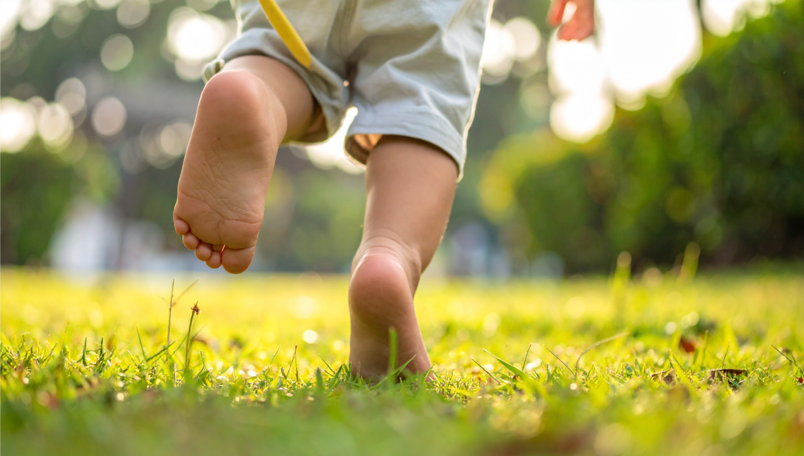

A child learning to walk offers one of life's clearest lessons. At first, every movement requires concentration. Through sight, sound, touch, movement and balance, a child learns to understand the world and respond to what it offers. Each tentative step brings new discoveries about what is possible. Gradually, balance improves, movements become more assured, and the child begins to look beyond the next step. The world is no longer simply a place to find one's footing, but a place to explore.

The purpose of learning to walk is not merely to avoid falling. It is to develop the ability to move towards something.

Our own development follows much the same pattern. We begin life with limited understanding of ourselves and the world around us. Through experience, we discover our abilities, recognise our limitations, form our aspirations and learn to navigate the circumstances we encounter. Over time, we become better equipped not only to move through life, but also to decide what kind of life we want to live.

## **Finding Our Direction**

There is an old Chinese saying that captures an important part of this journey:

### **心之所向，行之所至**

### ***Where the heart points, our actions can take us***

Our hearts represent what we value, desire and aspire towards. They give us a general sense of direction, even when we cannot yet see a clear destination. But knowing what we want is only the beginning. We must also understand what those aspirations mean in practice and how our choices can bring them closer to reality.

Consider someone who wants to build a successful career. Is success about financial security, professional recognition, making a difference, gaining independence or having more time for family? These aspirations may overlap, but they can also lead to very different decisions.

Without clarity about what matters most, it is easy to adopt other people's definitions of success. We pursue the next promotion because our peers are doing so, accumulate more because it seems sensible, or remain on a familiar path because changing direction feels too risky.

There is nothing inherently wrong with these choices. The question is whether they serve the life we want to live.

Understanding ourselves helps us distinguish between what we genuinely value and what we have simply learned to pursue. This understanding is never complete. Our priorities evolve as we take on new responsibilities, encounter different experiences and discover the consequences of our decisions. What once seemed important may lose its appeal, while something previously overlooked may take on new meaning.

The challenge is to remain attentive to these changes rather than continue pursuing goals simply because we have invested so much in them.

## **Developing the Capacity to Act**

Even when we have a clearer sense of direction, the way forward is rarely straightforward. We face competing priorities, incomplete information, limited resources and circumstances beyond our control. Good intentions alone cannot resolve these challenges.

We need to develop the capabilities that help us make sound decisions and turn aspirations into action.

**\#Critical thinking** allows us to question assumptions, examine evidence and consider different perspectives before reaching a conclusion. It helps us distinguish what we know from what we merely believe, and recognise when our decisions are being driven by habit, emotion or external pressure.

This is particularly important when a decision involves uncertainty. We cannot predict every outcome, but we can assess the information available, weigh the likely consequences and make a reasoned judgement. We must also be prepared to revise that judgement when circumstances or evidence change.

**\#Problem-solving** takes us from understanding a situation to working out what can be done about it. Rather than reacting to the most visible symptom, we learn to identify underlying causes, separate a complex problem into manageable parts and explore possible solutions. This helps us focus our efforts on the issues that matter most.

**\#Resourcefulness** enables us to work with what is available. We may not have the ideal skills, connections, time or finances to pursue a particular goal. But by drawing on our knowledge, relationships, creativity and available resources, we can often identify alternatives that would otherwise remain overlooked. Resourcefulness is not about pretending that constraints do not exist; it is about finding workable options within them.

Yet sound decisions and practical solutions do not guarantee success. We may put in considerable effort and still encounter rejection, disappointment or circumstances we cannot change.

This is where #**Resilience** becomes important. It helps us recover from setbacks, learn from what has happened and regain the confidence to continue. Resilience does not mean enduring every difficulty or persisting at all costs. Sometimes, the wiser response is to pause, seek help or recognise that a particular approach is no longer serving us.

Alongside resilience, #**Adaptability** allows us to respond to changing circumstances. The skills that helped us succeed in one stage of life may not be sufficient for the next. Career transitions, changing family responsibilities and new opportunities can all require us to reconsider established habits and develop different ways of thinking or working.

These capabilities complement one another. Critical thinking helps us judge a situation, problem-solving helps us identify a way forward, and resourcefulness helps us make use of what we have. Resilience helps us respond to setbacks, while adaptability allows us to change our approach as circumstances evolve.

Together, they strengthen our ability to act with intention rather than simply react to whatever happens.

## **Turning Intention into Action**

Understanding ourselves and developing our capabilities matter only when they influence how we live.

If we value meaningful relationships, we need to make time for the people who matter to us. If we aspire to greater independence, we need to build the skills and resources that support it. If we want to explore a different career, we may need to acquire new competencies, build relationships or accept a period of uncertainty while we make the transition.

These actions may seem small individually, but they help close the gap between the life we imagine and the life we experience.

Progress rarely follows a perfectly planned route. Some decisions produce the results we hoped for; others expose flaws in our assumptions or reveal that our priorities have changed. What matters is how we respond to what we learn.

We might discover that a goal is worth pursuing despite the difficulties. We might find a more effective way to achieve it. Or we might realise that the goal itself no longer reflects what we value.

Knowing when to persist, when to change our approach and when to reconsider our direction requires both self-awareness and sound judgement. It also requires the willingness to acknowledge that the effort we have already invested does not, by itself, justify continuing down a particular path.

Changing direction is not necessarily a retreat. It can be a deliberate choice informed by a better understanding of ourselves and our circumstances.

Nor should every decision become an exercise in endless analysis. At some point, we must be willing to act with the information we have, accept that uncertainty remains and learn from the outcome. Reflection without action leaves possibilities unexplored; action without reflection risks repeating the same mistakes.

The two must work together.

## **Progress on Our Own Terms**

It is tempting to measure our progress against the milestones of others. We see colleagues advancing in their careers, friends achieving financial success or people around us reaching significant life milestones, and wonder whether we are falling behind.

But we do not all begin from the same place, face the same constraints or aspire to the same outcomes. Our responsibilities, opportunities, abilities and circumstances differ. Even when our goals appear similar, the paths that make sense for us may be very different.

Other people's achievements can inspire us and offer valuable lessons. They should not automatically become the measure of our own success.

A person who chooses a less demanding career to spend more time with family is not necessarily less ambitious than someone pursuing senior leadership. Someone who changes careers in midlife is not necessarily behind someone who has followed a steady professional path. A person who pauses to recover, reflect or care for others is not necessarily standing still.

The more useful question is whether our choices are helping us build a life that reflects what matters to us, given the circumstances we face.

This requires honesty about both our aspirations and our limitations. Not every goal is attainable, and effort alone cannot overcome every constraint. We may need to revise our expectations, find another route or accept a trade-off. Such adjustments are part of making thoughtful decisions in a world where we can influence some outcomes but never control everything.

## **A Life Worth Moving Towards**

Personal development is not about becoming someone who never makes mistakes or reaching a point where uncertainty disappears. It is about becoming more capable of navigating the choices and challenges that life presents.

As we learn to understand ourselves, think critically, solve problems and adapt to changing circumstances, we gain greater capacity to decide what deserves our time and effort. We become less dependent on following established expectations and better equipped to make choices that reflect our own priorities.

This does not mean every step will bring us closer to our intended goal. Sometimes, experience will challenge our assumptions or lead us to reconsider what we want. That, too, is part of the journey.

The aim is not simply to make progress, but to make progress towards a life worth living.

**From Stumble to Strides** is about developing the understanding, courage and resourcefulness to shape that life for ourselves. We may not always know exactly where the journey will lead, but we can keep learning, make considered choices and become better equipped to decide where to go and how to move forward with confidence.