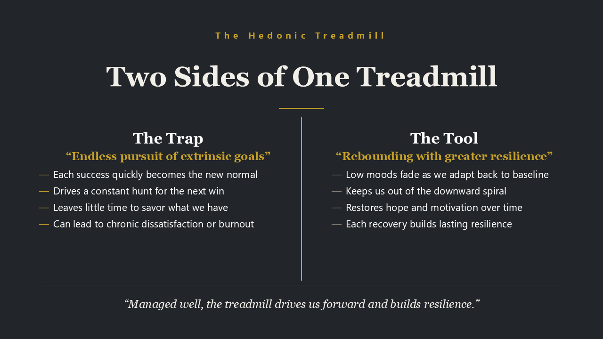

**Hedonic Adaptation**, sometimes called the **Hedonic Treadmill**, is our tendency to adjust to changes in life. The main concept behind this is that a positive or negative event can shift how we feel, but over time we often adapt and settle into a new normal.

That doesn’t mean we need to keep finding new triggers to be happy. But when we rely on external rewards for that lift, the endless pursuit can resemble an addiction, with each fading high tempting us to seek out the next stimulus. Chasing status, possessions, or achievement can become a trap: the rewards feel less novel as we adapt, while the time and energy spent pursuing them can add up to dissatisfaction and, for some, burnout.

There is another side to adaptation. As we adjust to difficult changes, we can build a new sense of what we’re able to live through. That doesn’t mean hardship always makes us stronger, or that we’ll be less affected the next time life goes south. But with time, support, and reflection, we may discover resilience we didn’t know we had.

Perhaps mindful attention can help us work with this tendency: noticing when we’re chasing a reward that no longer satisfies us, while also recognising how we’ve adapted and carried on through difficult times.

To find more lasting satisfaction, we may need to slow the treadmill and learn how to use adaptation to our advantage. A couple of practices may help:

1. **Prioritise intrinsic pursuits over extrinsic ones.** Personal growth, relationships, and contributing to the community may support more lasting well-being than status or material goals.
2. **Practise gratitude and mindfulness.** Appreciate what you already have, and take time to reflect on how new experiences have contributed to your well-being.

Ultimately, “stepping off the treadmill” doesn’t have to mean giving up ambition or living in isolation. It means refusing to let external acquisitions dictate your inner well-being.